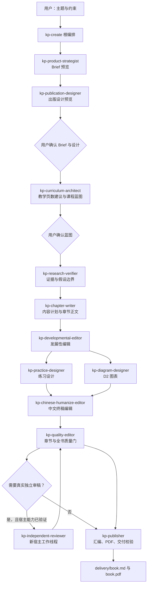

# Skill 架构与职责

Knowledge Product Workflow（KP）采用宿主驱动的多 Skill 协作模式：支持本地 Skill 的宿主（例如 Codex 或 Claude Code）负责理解用户意图和执行专业写作任务；`kp` CLI 负责保存工件、状态迁移、版本绑定、质量门和 PDF 渲染。KP 不内置或固定任何 LLM。确定性核心不请求模型；v1.4.0 的原生桥仅在明确额度、隔离与真实资格通过后使用宿主 App Server，默认零额度，当前真实生产资格仍待验。

本页说明的是**公开可部署的 14 个 Skill**。项目内的规范 `kp-*` Skill 包是唯一真源；`module/` 只是旧角色说明的兼容索引，不能作为安装源或修改目标。

## v1.4.2 读者任务与代码呈现

Brief 先确认 `teaching_focus`：`method_practice`、`implementation` 或 `mixed`。方法类教程保留完整提示、输入输出、失败对照和迁移练习；完整运行器可放配套资源，正文只保留讲清机制所需的片段。实现类教程仍可保留必要完整代码，不为所有题材设统一行数硬上限。旧书需经原 Brief 变更与确认流程显式采用，升级不自动改正文。

内容计划中的 `artifact_kind: prompt` 不要求附程序；`artifact_kind: code` 在新政策下须说明 `code_delivery`，选择 `inline_complete`、`excerpt_with_resource` 或 `resource_only`。资源路径限定本书 assets，片段按正文围栏序号与完整程序行号精确绑定；缺包、错绑、陈旧实跑证据不能发布。配套 ZIP 和成员清单随汇编事务生成，进入交付 QA 与最终交付清单；publish 不隐式补包。当前自动实跑只支持Python；其他语言资源可读但实跑未知时仍拒绝完整资源交付，不能把打包成功当已验证。

已有作者和编辑同时检查教学层次、阅读节奏、必要代码与完整练习，不增加固定审核角色或模型回合。程序、提示、数据和命令分开统计，聚合统计不因拆围栏变少；统计只定位复核，不能证明教学质量。提示与相关输入输出相邻，练习附参考与迁移，不强制卡片或图表配额。

本地 PDF 编译默认 300 秒；仅 `render-pdf --compile-timeout` 可显式设 1—600 秒，网络仍为 30 秒，失败不自动延长或重试。横向文字扫描只列页码、坐标与原文候选，必须看当前清晰页确认。视觉读视图仅限单次命令，完整字节与写前新鲜性核验保留；新规则的报告须重新量测，历史记录保留。

`kp outline-schema --json` 直接给实际蓝图输入模型，其中 `shared_context.cases` 为案例 ID 到对象的映射；`kp commands --all --command pdf-observation-template --json` 给该命令的精确参数，模板命令本身已输出 JSON，不再加 `--json`。

## v1.4.1 r0.5 操作变化

首次章节计划使用`content-plan-template <章号> --json`，一次取真实提交Schema，原文本输出兼容。新书证据政策1要求教学检查附当前单元原文引用与具体判断；视觉区分概览/细查、page/context，新Schema以当前模板为准，不用脚本默认passed。旧书显式`adopt-reading-policy --confirm`才迁移，已发布历史不自动撤销。

章末偶发空白可容忍；图表挤页致前页大白需修，同小节可浮动回填、长表可合法续页。35%只是跨页核查候选，不是密度自动质量分。

PDF提问前先request-user-decision明确scope，回复后record-user-decision记录实际scope再记录复核，不能把一般批准当本人全页覆盖。终检一次，publish复用完整current QA；报告缺失/陈旧/旧规则时先validate-delivery，不在publish隐式重算。需要续作时recovery-view读取operation_diagnostics并沿原op/tx处理；close-failed-operation须reason和完整证据，不自动结案。PowerShell前步非零立即停止依赖链，复用一次status --json结果，避免重复深扫。

## 使用原则

- 普通用户只需从 `kp-create` 启动或继续工作流。无需逐个点名子 Skill，也不需要输入工单、哈希、章节合约或审稿 JSON。
- 制作阶段在三个产品决策点确认：Brief、课程蓝图、第一章样章。PDF 交付另需绑定当前文件与明确范围的人审批准；一般回复不扩为用户完整检查全页。制作授权后说“继续完成全书，直到交付”即可让根 Skill 自动推进可安全执行的后续步骤。
- 一个子 Skill 不是一个固定模型，也不是一个必然独立的 API 调用。它是一份定义任务边界、输入输出、验收条件和禁止事项的可加载指令包。
- 专业 Skill 只能处理根编排器分配的当前工作单。输入版本改变、工单过期或章节租约冲突时，必须停止并交回根编排器重新路由。
- `kp` CLI 是确定性控制面，不是模型 Skill。它不编写课程或正文，也不替用户做产品决策。
- v1.3.5研究先核pending_claim_ids、逐声明验证并按同一证据组一次多--claim登记；章节已有源稿先消费readonly_diagnostics与check-chapter，当前报告复用、仅刷新必要项；视觉只填pending_pages，保留已有有效观察与失败／无图边界。
- 标准CLI主动作成功由CLI自动完成原工单并产生合法后继，根消费回执／状态，不另调手动完成。draft保持租约，辅助更新按原授权刷新，只读查询不收尾；手动完成仅保留明确获授权且满足原证明门的人工恢复兼容路径。

## 协作链路

研究、练习、图表和中文编辑都是章节作者租约中的协作动作，不能独立抢占或并行改写同一章节。质量编辑只校验和提出返工请求，发布者只生成派生交付物；两者都不能改写正文。

## 一览表

| Skill | 角色 | 何时调用 | 主要产出 |
| --- | --- | --- | --- |
| `kp-create` | 根编排器 | 用户创建、继续、校验或交付书稿时 | 用户可理解的阶段摘要、受控路由、审批请求和最终交付协调 |
| `kp-product-strategist` | 产品策略 | 创建或修订 Brief 时 | 可审阅的产品 Brief 预览 |
| `kp-publication-designer` | 出版设计 | Brief 形成后、首次展示前 | 受控出版设计预览与视觉 token |
| `kp-curriculum-architect` | 课程架构 | Brief 获批后 | 教学页数建议、主题化课程蓝图和章节预算 |
| `kp-research-verifier` | 研究核验 | 高风险事实、关键结论或研究影响需要确认时 | 来源台账、证据状态和影响判断 |
| `kp-chapter-writer` | 章节作者 | 蓝图与章节合约可执行后 | 指定章节的可教学正文源稿 |
| `kp-developmental-editor` | 发展性编辑 | 初稿与内容计划形成后 | 读者任务、工件与内容节奏的版本绑定报告 |
| `kp-practice-designer` | 练习设计 | 章节需要练习、任务或验收活动时 | 与章节版本绑定的练习建议/工件 |
| `kp-diagram-designer` | 图表设计 | 存在流程、架构、时序或对比关系时 | 语义图表定义和 D2 生成的受控图表资产 |
| `kp-chinese-humanize-editor` | 中文终稿编辑 | 正文和图表引用完成后 | 已检查的中文终稿与编辑报告 |
| `kp-quality-editor` | 质量编辑 | 每章提交、全书汇编前及返工后 | 章节合规映射、全书质量报告、返工结论 |
| `kp-independent-reviewer` | 独立审稿 | Brief 要求独立审稿且宿主能力通过预检时 | 版本冻结审稿结论，交回质量编辑处理 |
| `kp-publisher` | 出版交付 | 所有适用质量门通过后 | 汇编书稿、QMD、PDF、交付校验和发布清单 |

## 根编排 Skill

### `kp-create`

**职责。** 这是唯一的默认入口，适用于创建、继续、校验和交付知识产品。它读取当前工作区的真实状态，将用户的自然语言决定转换为受控动作，并把工作单路由给唯一正确的专业 Skill。

**用户交互。** 它只向用户呈现宏阶段、当前可审阅工件、下一次“继续/修改”决定、已完成结果以及可理解的阻断摘要。它不应暴露命令、路径、工单 ID、SHA、租约、审稿 JSON、来源台账或审批身份。用户说“批准”“可以”“继续”会被理解为对当前已展示版本的确认；用户提出具体调整则进入受控修订。

**关键控制。** 新工作区初始化后进入 `managed` 模式；根编排器只根据 `kp status --json` 和当前工作单推进，不猜测阶段。用户明确“继续完成全书，直到交付”后，它保持运行意图，除非遇到真实产品决策、不可自动修复的风险、用户暂停、宿主强制中断或最终交付，否则不应中途结束。

**不负责什么。** 它不直接创作领域正文、图表、审稿结论或最终质量结论，不把同一会话的角色切换伪装为独立审稿，也不能绕过 Brief、蓝图和样章确认。

## 定义与课程设计

### `kp-product-strategist`

**职责。** 将用户提出的主题和约束整理为可审阅的产品 Brief，明确读者、读者级别、语言、交付格式、版式、范围和审稿策略。它处理产品定位，而不是课程章节和正文。

**触发与输入。** 由 `kp-create` 在新书稿或 Brief 修订时分派；只使用当前工作区的输入与当前 CLI 帮助/错误，不应搜索源码、其他工作区、安装目录或网络来猜测字段。

**产出与交接。** 产出 Brief 预览，由根编排器展示给用户确认。获批 Brief 再交给 `kp-curriculum-architect`。页数和字数未提供时不会阻断；精确页数或区间页数会进入后续的教学篇幅建议流程。

**边界。** 不能把 CLI 的 `--confirm` 当作用户批准，不能在用户未确认时创建正式 Brief，也不能把出版标签、页脚等派生信息误当作需要重做 Brief 的内容约束。

### `kp-publication-designer`

**职责。** 将主题、读者和阅读场景转化为一次受控的出版设计预览。设计仅包含有限的视觉家族、配色、阅读密度、运行页眉和组件策略 token，由发布者映射到固定 PDF 模板。

**边界。** 它不写 TeX、CSS、QMD 或正文，不复制外部 PDF 风格，也不增加第四次用户审批。用户对 Brief 的确认同时确认该设计；后续仅修改出版设计只重建派生交付物。

### `kp-curriculum-architect`

**职责。** 将已批准的 Brief 转化为与主题匹配的课程蓝图，设计章节的教学目标、层级小节、章节体裁、必需教学单元、权重和预算依据；并对不合理的精确/区间页数给出“足以讲清主题”的教学篇幅建议。

**触发与输入。** 仅在 Brief 获批后由根编排器调用，读取当前 Brief、蓝图模板和 `kp outline-schema`。用户不需要填写 `required_units`，缺省值由 CLI 按章节体裁补全。

**产出与交接。** 产出主题化蓝图，而非通用模板；用户确认后，CLI 编译章节合约。蓝图和合约再交给研究核验与章节写作。每章预算按教学权重分配，不能为凑字数机械平均分配。

**边界。** 不能硬编码领域章节标题，不能让模板伪装成完成的课程蓝图，不能跳过用户对结构和页数扩展决定的确认。

### `kp-research-verifier`

**职责。** 为高风险结论建立可追溯的证据边界，核验来源并评估研究发现会不会影响产品定位、蓝图权重、内容结论或仅影响包装。

**触发与输入。** 当章节合约声明需要来源的 Claim，或研究结果可能改变课程内容时，由章节作者租约内或根编排器的受控工作单调用。它只读取当前工作区的合约、来源和研究输入。

**产出与交接。** 写入来源台账、假设状态和研究影响：`no_product_change`、`packaging_change`、`content_change` 或 `unverified`。已验证事实和明确的假设边界交给章节作者。

**边界。** 它不写读者正文。`content_change` 必须回到 Brief/蓝图确认与合约重编译；无法证实的内容必须降级为读者可见的情境案例，不能伪装成真实统计、典型经验或确定结论。来源台账和 Claim ID 永远不能进入最终书稿。

## 章节生产协作

### `kp-chapter-writer`

**职责。** 在指定章节的唯一正文租约内，根据已批准蓝图、章节合约和已核验事实写出可教学的章节正文，并整合练习、图表和中文终稿结果。

**触发与输入。** 仅在蓝图批准、章节合约可用且根编排器分派该章节时运行。输入包括本章合约、允许的研究结论、章节源稿和当前章节工作单。

**产出与交接。** 产出章节源稿；需要时请求研究、练习和图表协作。图表引用、中文终稿检查完成后，将章节移交质量编辑做合规映射与受控提交。第一章样章必须先等待用户确认，不能自动批量写后续章节。

**边界。** 不能自行计算或填写章节/合约哈希、章节编号、内部 Schema 或资产清单；不能使用 ASCII 字符画，不能为了凑页数加入没有教学意义的图片，也不能并行改写其他章节。

### `kp-developmental-editor`

**职责。** 在初稿和中文终稿之间检查章节是否兑现内容块计划：读者任务是否清楚、计划的图表/表格/工作表是否存在、工作表是否可填写，以及解释段是否过度连续。

**边界。** 它不直接改写正文，也不使用“AI 味分数”判断质量。确定性缺失才阻断；阅读节奏和结构建议以 warning 交回章节作者处理。报告与正文、合约、内容计划和保护片段哈希绑定，任一变化都会使报告过期。

### `kp-practice-designer`

**职责。** 设计与章节学习目标对应的练习、任务、案例、验收标准和反馈提示，帮助读者检验是否能把概念用于真实场景。

**触发与输入。** 由章节作者在自身租约内按章节需要调用，读取本章合约、目标读者、教学目标和当前正文。

**产出与交接。** 只写本章版本绑定的练习建议或专用练习工件；章节作者负责将合适内容整合进正文，随后进入中文终稿和质量编辑。

**边界。** 不拥有正文租约，不能单独改写章节或覆盖作者内容；不把每一节强行做成同一种“标准答案/验收标准”模板，应让练习的形式服务于教学目标。

### `kp-diagram-designer`

**职责。** 将适合视觉表达的流程、架构、时序、生命周期、层级或对比关系转换为有教学目的的图表资产，使用 D2 的受控链路生成可嵌入 PDF 的图。

**触发与输入。** 由章节作者在自身租约内发起，先使用图表模板填写语义信息，再创建受控引用、编辑图注并提交图表。仅接受当前工作区中的章节源稿和允许资产路径。

**产出与交接。** 产出 D2 图源和受控生成的图表资产，供章节正文引用。图注会进入中文终稿检查，最后由质量编辑与发布者校验和渲染。

**边界。** 不把 ASCII 文本框或无教学价值的装饰图作为图表；不直接写章节散文，不引用工作区外资产，不提交重复图注或导致图表独占整页、文字无法辨认的资产。

### `kp-chinese-humanize-editor`

**职责。** 对中文专业教程做终稿文字编辑，减少机械重复、模板化断言、无信息量“金句”、过密加粗/破折号、装饰性编号框架、伪精确数字和不自然的 AI 腔，同时保留技术准确性、术语和教学结构。

**触发与输入。** 在章节正文与图表引用完成后，由章节作者在自己的租约内调用。输入是同一版本的章节源稿及其图表文字。

**产出与交接。** 产出编辑后的章节源稿和与其版本绑定的终稿检查结果。正文或章节合约变化后，该结果失效，必须重新执行；随后交给质量编辑。

**边界。** 不是依赖 AI 检测分数的“洗稿器”，不应虚构第一人称经历、真实数据、引文或来源；不能改变经过核验的技术结论、读者承诺、章节合约和教学目标，也不能单独提交章节。

## 质量与交付

### `kp-quality-editor`

**职责。** 对章节和全书执行确定性质量门，并将问题转化为可归属的返工请求。它检查章节合约匹配、标题编号与顺序、必需教学单元、内部标记泄漏、重复/占位符、质量报告版本和交付前置条件。

**触发与输入。** 每章在终稿编辑后交给它生成合规模板与受控提交；全书章节完成后再运行质量检查。若 Brief 要求独立审稿，则由它创建一次性冻结的审稿批次和每章审稿任务。

**产出与交接。** 产出章节合规映射、章节提交状态、全书质量报告及返工结论。无 blocker 的质量报告才能交给发布者。收到独立审稿 Skill 的冻结快照结论后，它负责消费结果并决定是否返工。

**边界。** 它不改写章节散文，不自行虚构审稿通过，不让用户处理章节级内部命令。独立审稿被要求时，不能用同一会话的角色切换替代真实独立任务。

### `kp-independent-reviewer`

**职责。** 对冻结的章节、合约和最小证据集进行独立的教学/面试 Rubric 审查，给出与被审版本绑定的结论，避免作者自己给自己签字。

**触发与输入。** 只由质量编辑在冻结批次准备完成后调用。只有宿主平台确实能创建独立、可返回父子任务回执的 `Quality review` 工作线程，并且 Brief 选择 `independent_review_required` 时，才可作为交付门中的独立审稿运行。

**产出与交接。** 它只把冻结快照的审稿结论交回质量编辑和根编排器。正文或合约改动后，受影响章节必须进入新的审稿批次；旧报告不能继续作为通过证据。

**边界。** 不直接与用户交互，不修改正文、不获取作者租约、不创建后续批次；能力回执缺失时只能作为宿主诊断，不能标记为独立审稿通过。默认 `deterministic_only` 策略不需要它。

### `kp-publisher`

**职责。** 在适用质量门通过后，将受控章节汇编为读者交付的 Markdown，并在要求 PDF 时通过固定 Quarto/XeLaTeX 链路生成 PDF、执行交付校验和发布清单。

**触发与输入。** 仅在质量编辑的报告无 blocker 且根编排器当前工作单允许交付时运行。读取已提交章节、受控资产、出版配置和有效质量报告。

**产出与交接。** 产出 `delivery/book.md`、`delivery/book.qmd`、按需生成的 `delivery/book.pdf` 以及交付清单。封面、目录、书签、页数、字号、图注、内联代码、资产版本和泄漏规则均在此阶段受控验证；客户只接收 Markdown/PDF，不接收内部工件。

**边界。** 不改写章节正文或质量结论；不得绕过 `kp render-pdf` 直接调用 Pandoc、Quarto、LaTeX 或其他渲染器。PDF 环境缺失时应报告可理解的诊断和修复路径，不得声称已经交付。

## 审稿策略与宿主能力

默认策略 `deterministic_only` 使用可重复运行的确定性质量门，适合所有兼容宿主。`independent_review_required` 是可选的更强策略，不是“让同一个模型换一个角色再读一遍”。它要求宿主平台能真实创建独立工作线程、绑定父任务并返回可验证回执；不满足时，根 Skill 必须在 Brief 获批前以用户可理解的方式阻断，而不是生成蓝图、章节或伪造审稿通过。

因此，Skill 的职责分工不等于每一步都会产生一个独立模型调用。是否能启动真正的子任务，取决于宿主平台能力；KP 的控制面会记录可验证的事实，而不是猜测模型是否独立。

## 安装、版本与贡献

安装和升级时，按当前宿主支持的本地 Skill 机制导入规范 `kp-*` Skill 包及共享编排契约。不要以复制旧模块目录、修改运行日志或绕过质量门代替规范安装与升级。

新增或修改任一 Skill 时，必须同步更新其 `SKILL.md` 元数据、包清单、本页的职责说明及对应的 CLI/回归测试。变更不能通过只改提示词绕过状态机、人工确认或确定性质量门。

## v1.4.0 隔离并行生产基础

新书请求自适应、旧书保持串行；`kp production-plan --workspace <书稿> --json`在写作前列公共约定、navigation/interface/result依赖、就绪与阻断。4/5/6为全部子代理共享候选总池；多章候选、滚动送审、私有证明、幂等和单写者提交保留原质量/人工门。当前真实宿主资格仍pending，实际原生生产保持串行，不能宣称已支持真实4~6或效率通过。`production-start --diagnostic`和模拟仅私有诊断，不满足生产或发布门；不自动安装、同步、迁移、重启或发布。
# v1.4.0 精确更新与恢复（2026-10-15）

根Skill首次进入或换模型恢复先读取recovery-view与当前工单；专业角色只接收相关章节及实际依赖，不反复全书重读。课程角色在写作前明确typed依赖、共享约定，修订前预览影响；作者区分正文修订与证明更新，审稿角色只复核失效领域并保留原件。独立后章可绕开待修章继续；最终出版不能绕开债务。新书policy2，旧书显式迁移，不自动恢复撤销批准，详见共享编排契约。

## 2026-10-16 · v1.4.0效率修正（隔离工程，未部署）

- 本地CLI提交使用原进程／父工具句柄，由一个等待owner负责；不能额外创建只会sleep、询问进度或转发“仍在运行”的LLM协调者。提交可预先指定`--operation-id op-<唯一标识>`，加`--operation-events`在stderr取得早期ID与阶段JSONL；正常stdout兼容原格式。
- 等待先查`kp operation-status --workspace <workspace> --operation-id <原ID> --json`，或由一个程序执行`kp wait-operation --workspace <workspace> --operation-id <原ID> --timeout 60`。它只读固定回执／原事务，不用深status替代心跳；一个动作不多层轮询。正文提交与控制面收尾分别记录；断流／超时先核原进程与回执，domain完成只`recover-operation`补原事务／控制面，禁止重发submit-chapter或再次执行示例。unknown不猜结束、不释放槽位。
- 原生通道在同一认证与ledger进程使用有界`run_until_attention`；默认只收原回执，`authorized_actions`明确授权dispatch/freeze/commit后才可自动推进；commit还要同版本task_id/context/compliance，不能合成语义证明／用户批准。保持共享总池，失败／EOF／deadline保留未知，不重试未知派单。暂停不派新任务。
- U11真实宿主的无推理守候／可见反馈接线仍pending。程序本地heartbeat≤30秒不算真实进展；未经实际宿主证明不能宣称“零推理守候已接入”。当前降级为单父代理有界等待，按宿主可见能力满足≤60秒反馈，必要模型回合如实计入开销。
- 每个任务／候选版本创建新角色上下文，依据结构化handoff的task/version/manifest、完成项、待办、相关输入和unknown继续；不默认累积全书聊天，不为报进度反复读章。作者读批准公共设定、本章合约／计划和显式依赖。编辑／审稿读完整冻结当前章与全部必需比较单元；缺材料明确请求缺失范围，禁止猜测、截断必要原文或把摘要当原文。当前完整章及必要引用不能为节约Token被省略。
- 同一证据组先逐声明核验，再一次research重复`--claim`关联多项；当前Schema版本首次发现并复用，内容计划依本章template填写，禁止失败提交探索枚举。证明更新用refresh-chapter-proofs／recheck-chapter，按真实依赖局部复核，独立后续章继续；最终质量门仍必须收齐债务。

原因：同动作重复深检与路由、全书嵌套解析、仅按阶段计进展、领域已提交却缺控制回执、多层模型等待共同放大耗时。代码分别由verification_context、局部索引／ledger视图、finish_controlled_action、operation_receipts和run_until_attention承担；journal仍是领域事实，回执不授新权。真实宿主资格、U11反馈接线与生产效率结论分别记录，离线协议不能替代。
